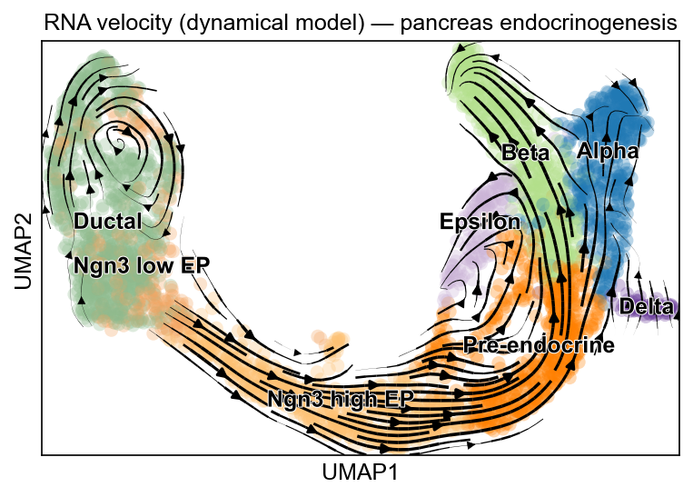
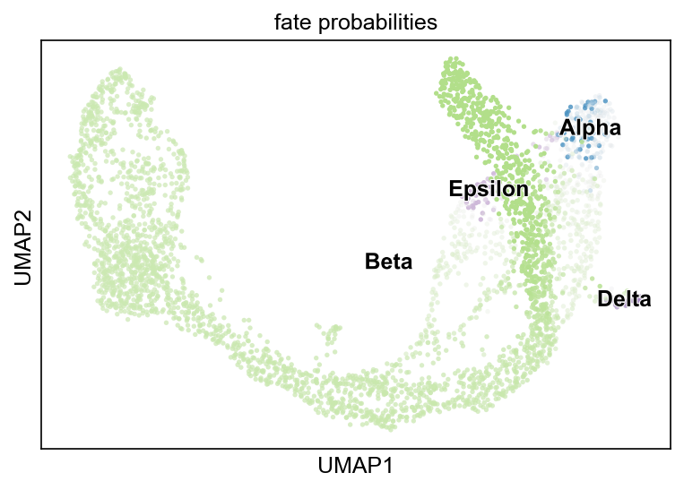
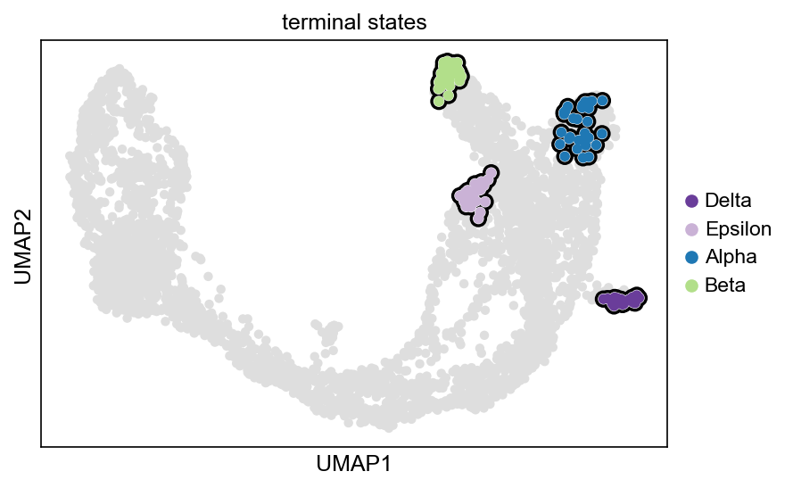
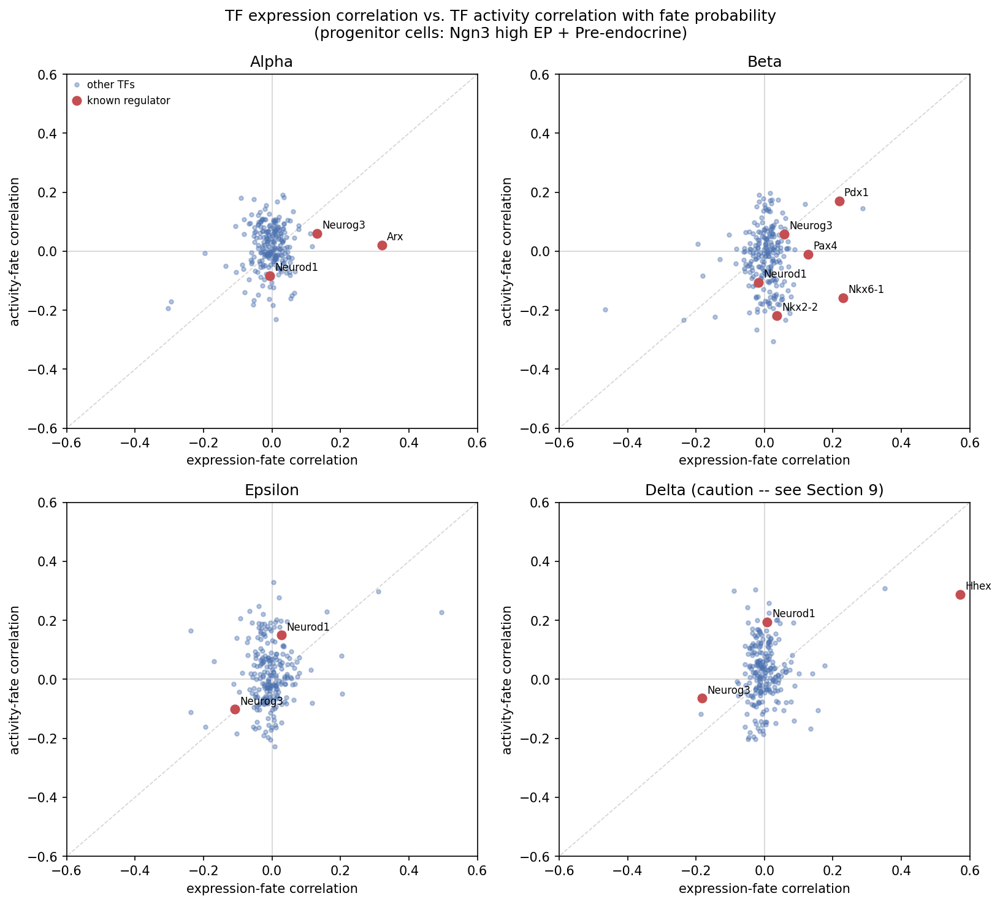

# Do CellRank's data-driven fate drivers agree with curated regulatory knowledge?

This project asks a narrow, concrete question: when CellRank 2 ranks genes by how well their
progenitor-stage expression predicts a cell's eventual fate, do the top-ranked genes line up with
transcription factors already known, from decades of mouse pancreas developmental biology, to
specify that fate? And separately: does a TF's *expression* level agree with its *inferred
regulatory activity* (via CollecTRI target genes) in predicting fate?

The dataset is scVelo's pancreas endocrinogenesis dataset (Bastidas-Ponce et al. 2019), E15.5
mouse, 3696 cells spanning Ductal progenitors through four mature endocrine types (Alpha, Beta,
Delta, Epsilon). The main result is mixed. CellRank's top-ranked drivers recover several
well-established regulators (Arx, Hhex, Pdx1, Nkx6-1). In this setup, however, the fate
probabilities show a strong bias toward the most abundant terminal state (Beta), and a TF's
expression and its CollecTRI-inferred activity agree only at chance level about which TFs predict
fate.

## Motivation

A dynamics model (RNA velocity, a Markov chain over cells, absorption probabilities) can fit the
data well — reproduce the right trajectory shape, rank the right genes near the top — without any
of its intermediate quantities necessarily reflecting the actual regulatory mechanism driving the
system. That gap matters if the ranked gene list is going to be used to prioritize follow-up
experiments. This project tests the gap in a small, concrete setting: one well-studied dataset,
one established method (CellRank 2), and one independent cross-check (CollecTRI + target-based TF
activity inference) that doesn't depend on the velocity model at all.

## Approach

**`notebooks/01_velocity.ipynb`** — Standard scVelo preprocessing (filtering, normalization,
moments) and the dynamical model fit, producing per-cell, per-gene RNA velocity estimates. This is
the foundation everything downstream depends on; no CellRank-specific choices are made here.

**`notebooks/02_cellrank_fates.ipynb`** — Builds a CellRank 2 `VelocityKernel` (blended with a
`ConnectivityKernel`), runs GPCCA to find macrostates, identifies the four terminal states and the
Ductal initial state, computes per-cell fate probabilities, and ranks driver genes per lineage by
their correlation with fate probability. Along the way, two things needed fixing rather than taking
at face value: the automatic terminal-state detector found only 2 of the 4 known fates, and an
initial attempt to stress-test the fate-probability estimates turned out to be invalid (see Key
Findings below) and had to be corrected before its conclusion could be trusted.

**`notebooks/03_collectri_validation.ipynb`** — Takes the driver gene lists from notebook 2 and
checks them two ways: against a literature-fixed list of known pancreatic regulators, and against
independent TF-activity scores inferred from the mouse CollecTRI regulatory network via
`decoupler`'s ULM method. The second check required working around a dead download URL inside the
installed `decoupler` version (see Reproducing).

## Key findings

**(a) Known regulators are recovered at the top of the list, with one informative exception.**
*Arx* is CellRank's #1 driver (of 7197 genes) for the Alpha lineage (r = 0.32), *Hhex* is #1 for
Delta (r = 0.57), and *Nkx6-1* (#6, r = 0.23) and *Pdx1* (#8, r = 0.22) are both top-10 for Beta —
all four match the classical knockout literature. *Nkx2-2*, also a well-established beta regulator,
ranks 1076th (r = 0.037). This is consistent with *Nkx2-2* being broadly expressed across
progenitors rather than fate-discriminating: its mean expression in the two progenitor clusters used
for the correlation (Ngn3 high EP: 0.19; Pre-endocrine: 0.14) is already similar to its level in the
mature Beta, Alpha and Epsilon clusters (0.12–0.16) — so a progenitor's *Nkx2-2* level carries little
information about *which* fate it is heading toward, even if the gene is later required for the
Beta program specifically.

**(b) A Beta "sink" effect in the fate probabilities — diagnosed, and a flawed first attempt to
test its robustness, corrected.** Outside the 30 highest-confidence anchor cells per terminal
state, most cells already annotated as Alpha, Delta or Epsilon are predicted *more* likely to end up
Beta than their own annotated fate (e.g. Delta cells: 36.1% predicted Delta vs. 61.0% predicted
Beta). Velocity confidence doesn't explain this for Delta or Epsilon — both have average-to-highest
velocity confidence in the dataset; only Alpha's velocity signal is genuinely weak. The likely cause
is structural: Beta is the largest terminal population (591 of 3696 cells) and appears to act as a
disproportionately strong sink in the transition matrix. A first attempt to test whether this was
sensitive to the terminal-state anchor-set size (`n_cells=100` vs. the default 30) was itself
invalid: GPCCA's `n_cells` parameter selects cells by raw membership score alone, and since Delta
has only 70 cells in the whole dataset, asking for 100 anchors pulled in 33 real Ductal cells and 10
Ngn3 low EP cells, which were then forced to ~100% Delta probability by construction — producing a
spurious ~375× swing in Ductal's apparent Delta probability. After restricting anchors to cells that
already carry the matching cluster label, the real picture is calmer: **the fate ranking is robust
to anchor choice, while the magnitudes are moderately sensitive** (Beta drops 12–16% across
progenitor clusters; Epsilon rises by as much as +65% in Pre-endocrine cells; Delta rises about 6×
but stays roughly two orders of magnitude below the other three fates throughout).

**(c) TF expression and CollecTRI-inferred TF activity agree only at chance level.** For 232 TFs
present in both the dataset and the mouse CollecTRI network, the naive Spearman correlation between
a TF's expression-fate correlation and its activity-fate correlation is approximately zero for every
headline lineage (Alpha ρ = 0.006, Beta ρ = 0.043, Epsilon ρ = 0.053). Restricting to only the TFs
significant (FDR < 0.05) in at least one view doesn't rescue this: the restricted Spearman stays
near zero (Alpha −0.016, Beta −0.014, Epsilon 0.084), sign concordance stays close to the 50%
coin-flip baseline (Alpha 55.0%, Beta 46.7%), and the overlap between each view's top-20
TFs is never more than 3 of 20 — never beating chance by a permutation test (p = 0.849, 0.246, 0.241
for Alpha, Beta, Epsilon respectively). Re-running the same comparison on the full, unfiltered gene
panel (not just the 7197 genes that survived the velocity-specific QC filter) left every one of
these numbers within noise of the original, ruling out gene-panel filtering as the explanation.
This is not surprising in itself, since a transcription factor's mRNA level is an imperfect proxy
for its regulatory activity (post-transcriptional regulation, cofactors and sparse single-cell
counts all intervene), but it means the two views cannot be used interchangeably to prioritise
regulators in this setting.

**(d) The Arx/Epsilon case, framed as a hypothesis.** Expression alone can't distinguish whether Arx
drives Alpha or Epsilon (r = 0.32 and r = 0.49, both substantial). Activity points more toward Epsilon:
Arx's activity correlation with Alpha drops to noise (r = 0.02) while a moderate positive
correlation with Epsilon remains (r = 0.23), on a reasonably sized regulon (17 of Arx's targets are
present in the dataset, above the 10-target reliability threshold used throughout notebook 3).
One possible reason activity doesn't resolve this more cleanly: of those 17 targets, CollecTRI lists
15 as activating and only 2 as repressing — but Arx is mainly characterized in the islet literature
as a transcriptional *repressor* (it represses the Pax4/beta program to enforce the alpha fate;
Collombat et al. 2003). If CollecTRI's mode-of-regulation calls for Arx don't reflect its dominant
repressive role in this specific system, that mismatch could itself be dampening the activity
signal — a hypothesis, not something this analysis can confirm.

## Figures

| | |
|---|---|
|  | RNA velocity streamlines on the UMAP embedding, showing the expected Ductal → Ngn3 → four-endocrine-type flow (`notebooks/01_velocity.ipynb`). |
|  | Combined fate-probability map; the Beta-green hue dominating most of the embedding, well beyond the Beta cluster itself, is the visual signature of finding (b) (`notebooks/02_cellrank_fates.ipynb`). |
|  | The four GPCCA terminal states (Alpha, Beta, Delta, Epsilon), 100% pure against the dataset's own cluster labels at the default anchor-set size (`notebooks/02_cellrank_fates.ipynb`). |
|  | TF expression-fate correlation (x) vs. activity-fate correlation (y) per lineage; known regulators labeled — the lack of diagonal alignment is finding (c) (`notebooks/03_collectri_validation.ipynb`). |

## Limitations

- **One dataset, one developmental stage.** Everything here is specific to E15.5 mouse pancreas
  endocrinogenesis; none of it has been checked against a second dataset or timepoint.
- **Correlation is not causation**, anywhere in this analysis — not in the CellRank driver
  rankings, and not in the TF-activity comparison.
- **CollecTRI is largely derived from human studies** across many tissues, translated to mouse by
  gene-symbol orthology only; the underlying regulatory evidence was not re-verified in a pancreatic
  or mouse-specific context.
- **Delta has only 70 cells** in the entire dataset, and its progenitor fate probabilities are tiny
  (roughly 0.001–0.03) — every Delta-specific number in this analysis is reported separately and
  should be read as suggestive, not confirmatory.
- **Velocity-specific preprocessing removed real, lineage-patterned genes.** *Mafb* and *Pou3f4*
  both show substantial, cluster-specific expression in the raw data but have zero detected
  unspliced (intronic) counts, so they failed scVelo's `min_shared_counts` filter and are absent
  from every CellRank result in this repository — a reminder that a gene's absence from a
  velocity-filtered panel says nothing about its biological relevance.
- **Which view is "right" can't be settled here.** Resolving whether expression correlation or
  CollecTRI-based activity better reflects the true regulatory relationship would need perturbation
  data (knockouts, ChIP-seq, or similar) in this exact system — outside the scope of a
  correlation-only analysis.

## Reproducing

**Environment.** `environment.yml` pins the exact versions used to produce every result in this
repository (Python 3.10.11, scanpy, scvelo, cellrank, decoupler, and their key dependencies). Create it
with `conda env create -f environment.yml` (or install the same package list with `pip` in a plain
virtual environment).

**Notebook order.** Run `01_velocity.ipynb`, then `02_cellrank_fates.ipynb`, then
`03_collectri_validation.ipynb` — each one loads the previous notebook's saved output. Notebooks 2
and 3 each take several minutes (Schur decomposition and GPCCA in notebook 2; network downloads and
permutation tests in notebook 3).

**`data/` is not committed.** It's regenerated by running the notebooks: notebook 1 downloads the
raw dataset via `scv.datasets.pancreas()` (cached locally after the first run) and writes
`data/pancreas_velocity.h5ad`; notebook 2 writes `data/pancreas_fates.h5ad`. Both files are a few GB
combined, which is why they're excluded from version control (see `.gitignore`).

**The HCOP URL workaround.** The installed `decoupler` (2.1.4) fetches its human→mouse ortholog
table from a now-dead `ftp.ebi.ac.uk` URL (HGNC migrated HCOP's bulk-download files to a Google
Cloud Storage bucket). Notebook 3 documents this and works around it automatically, by
replicating `decoupler`'s own translation logic against the current URL — no manual steps are
needed to reproduce it, but it's worth knowing about if a future `decoupler` release fixes the
upstream URL and this workaround is no longer necessary, or if the replacement URL itself moves.
The translated network is also saved to `results/collectri_mouse.csv` so re-fetching it isn't
required at all to reproduce notebook 3's downstream results.
